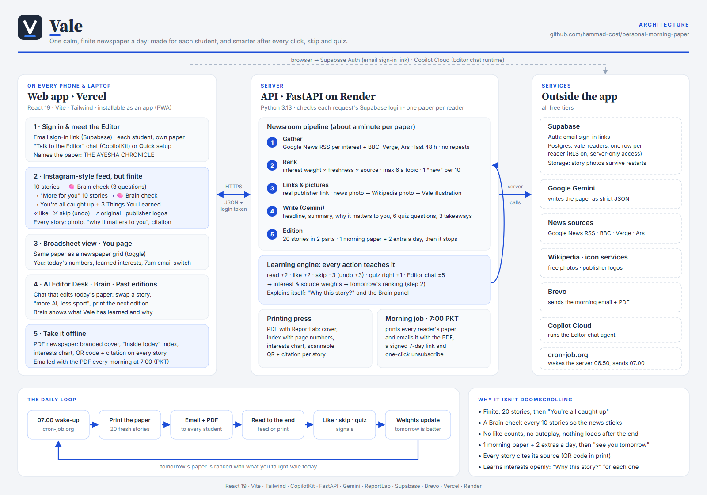

# Vale

**One calm, finite newspaper a day: made for each student, and smarter after every click, skip and quiz.**

Social media gave us a feed that never ends. Vale gives news a paper that does: 20 stories picked for you, a quick Brain check every 10 so the news actually sticks, then *"You're all caught up"*. Read it as an Instagram-style feed, as a broadsheet, or as a printed PDF with a QR code to every source, emailed to you at 7:00 every morning.



---

## Run it locally

| Part | Link |
|---|---|
| **Frontend** (the app) | **http://localhost:5173** |
| **Backend** (API) | **http://localhost:8000** |
| API docs (Swagger) | http://localhost:8000/docs |
| Health check | http://localhost:8000/api/health |

You need **Python 3.11+** (3.13 used), **Node 22.12+**, a **Gemini API key** ([Google AI Studio](https://aistudio.google.com)) and a **Copilot Cloud public key** ([cloud.copilotkit.ai](https://cloud.copilotkit.ai)).

```bash
git clone https://github.com/hammad-cost/personal-morning-paper.git
cd personal-morning-paper
```

**1. Backend** → http://localhost:8000

```bash
cd backend
python -m venv venv
# Windows: venv\Scripts\activate    macOS/Linux: source venv/bin/activate
pip install -r requirements.txt
cp .env.example .env          # set GEMINI_API_KEY (the rest is optional, see below)
uvicorn app.main:app --port 8000
```

**2. Frontend** → http://localhost:5173 (second terminal)

```bash
cd frontend
npm install
cp .env.example .env          # set VITE_COPILOTKIT_PUBLIC_API_KEY
npm run dev
```

Open **http://localhost:5173**. Vite forwards `/api` to the backend on port 8000.

With only the Gemini and Copilot keys, Vale runs in **local mode**: one reader, no sign-in, data in `backend/data/store.json`. Add the Supabase keys for real accounts (every student gets their own paper) and the Brevo keys for the 7am email; `.env.example` in each folder explains every value.

---

## What it does

1. **Sign in** with an email link (Supabase). No password; each student gets their own paper.
2. **Meet the Editor**: a CopilotKit chat asks who you are and what you care about, and builds your Reader Profile live beside the chat. Your paper gets your name: *THE AYESHA CHRONICLE*. (A 30-second Quick setup form is the fallback.)
3. **Vale prints your paper**: it gathers the last 48 hours of news on your interests, ranks it, finds each story's real publisher link and a photo, and Gemini writes each headline, summary and *why it matters to you*.
4. **Read a feed that ends**: 10 stories → 🧠 Brain check (3 questions) → *More for you*, 10 stories → Brain check → *You're all caught up* and **3 Things You Learned**, built from your answers. Each post has the publisher's logo, a photo and a citation; ♡ like, ✕ skip (with Undo), ↗ open the original.
5. **It learns**: every read, like, skip, quiz answer and Editor request changes your interest weights, and tomorrow's paper is ranked with them. *Why this story?* and the **Brain** panel show exactly why.
6. **Edit it by chat**: the **AI Editor Desk** swaps stories, tunes interests (*"more AI, less sport"*) and prints the next edition. After the morning paper you get 2 extra a day, then *"See you tomorrow."*
7. **Take it offline**: a **PDF newspaper** with a branded front cover, an *Inside today* index with page numbers, a *What Vale has learned about you* chart, and a scannable **QR code + citation on every story**, emailed with the PDF every morning at 7:00 (Asia/Karachi).

Also: a **Broadsheet** view of the same paper, a **You** page (today's numbers, learned interests, morning email switch), **Past editions**, and an installable web app (PWA) with an Instagram-style layout: sidebar on computers, bottom tabs on phones.

## Hackathon requirements

| # | Requirement | How Vale meets it |
|---|---|---|
| 1 | Onboarding that captures interests with great UX | **Talk to the Editor** (CopilotKit chat) fills a live Reader Profile card: name, paper name, interest pills with weights, blocked topics, bio. Pills are editable and the chat sees the edits. Quick setup as fallback. |
| 2 | Daily PDF in a newspaper layout, personalised | Branded cover with the reader's own masthead and lead story, *Inside today* index, interests chart, 3 ruled columns, a photo plus QR code and citation per story, skipped stories left out. Emailed daily with Brevo. |
| 3 | Full web reading experience, same edition, previous papers | Instagram-style finite feed or broadsheet grid of the same edition, Past editions drawer, PDF download, email. |
| 4 | Learns over time | Signals change topic and source weights; weights decide what appears and where; the Brain panel explains every change; tomorrow's paper (or *Print next edition*) shows it. |
| 5 | Room to explore | Brain checks between parts, 3 Things You Learned from your answers, a *Something new* story per 10, publisher logos, scannable QR codes, the AI Editor Desk. |

## How a paper is made

1. **Gather** (`gatherer.py`): one Google News RSS query per interest plus BBC, The Verge and Ars Technica; last 48 hours; duplicates removed by URL and near-identical headline.
2. **Rank** (`ranker.py`): `interest weight + freshness bonus + source weight`, minus already-printed and bare-domain penalties. 20 stories in 2 parts of 10, at most 6 per topic, one *Something new* story per 10.
3. **Links and pictures** (`images.py`, `photos.py`, `logos.py`): Google News links decoded to the real publisher; the news photo, else a free Wikipedia photo of the subject or topic, else a drawn Vale illustration. Every story gets a picture.
4. **Write** (`ai_editor.py`): one Gemini call returns strict JSON (headlines, summaries, why it matters, 6 quiz questions, 3 takeaways), validated with Pydantic against the real story ids, with a no-AI fallback.
5. **Save** (`editions.py` → `store.py`): one morning paper per day plus 2 extras, in Supabase (or a local file in local mode).

### How it learns (`learning.py`)

| Signal | Topic weight | Other effect |
|---|---|---|
| Read original | +2 | source +1 |
| Like ♡ | +2 | source +1 |
| Skip ✕ | −3 | hidden, left out of the PDF |
| Undo skip / unlike | +3 / −2 | reverses it |
| Brain check right | +1 | |
| Editor Desk "more / less" | ±5 | logged in the reader's own words |

Weights are clamped to −15 … 25; negative topics are never fetched.

## Tech stack

- **Frontend:** React 19, Vite, Tailwind CSS v4, CopilotKit (`@copilotkit/react-core/v2`, Copilot Cloud), Supabase JS, lucide-react, zod.
- **Backend:** Python, FastAPI, Pydantic, feedparser, httpx, Google Gemini (`google-genai`), ReportLab (PDF and QR codes), Pillow, Brevo (email).
- **Data:** Supabase Auth, Postgres (`vale_readers`, RLS on, server-only access) and Storage (story photos).
- **Tests:** pytest (181) and Vitest + React Testing Library (115). All network and AI calls are mocked.

```bash
cd backend && pytest -q
cd frontend && npm test -- --run
```

## Deploying (optional)

`render.yaml` puts both halves on Render's free plan (API web service + static site), and [`docs/DEPLOY.md`](docs/DEPLOY.md) walks through it, including the 7am wake-up with cron-job.org.

## Project layout

```
backend/app/    main.py (API) · gatherer · ranker · images · photos · logos · ai_editor
                editions · learning · pdf · mailer · daily (7am job) · auth · store · storage · links
backend/tests/  pytest suite + saved RSS fixtures
frontend/src/   App.jsx · api.js / apiBase.js (the only backend calls) · auth/ · copilot/
frontend/src/components/  AppShell, FeedView, Paper, BroadsheetGrid, StoryCard, RecallCheck,
                          ThreeTakeaways, YouPage, EditorDesk, EditorInterview, Onboarding, ...
docs/           architecture diagram source · DEPLOY.md
```

Built step by step from [`BLUEPRINT.md`](BLUEPRINT.md), one commit per step.
