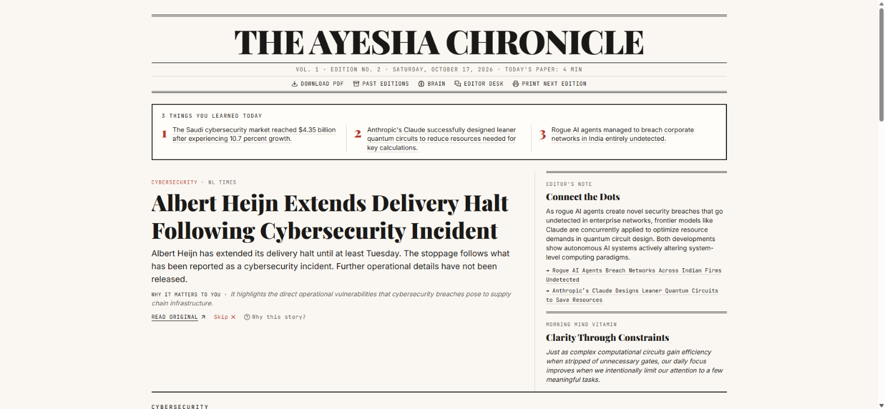
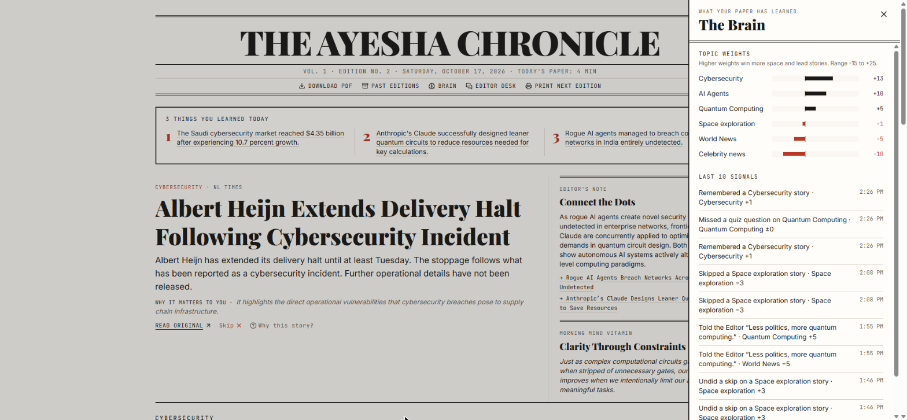
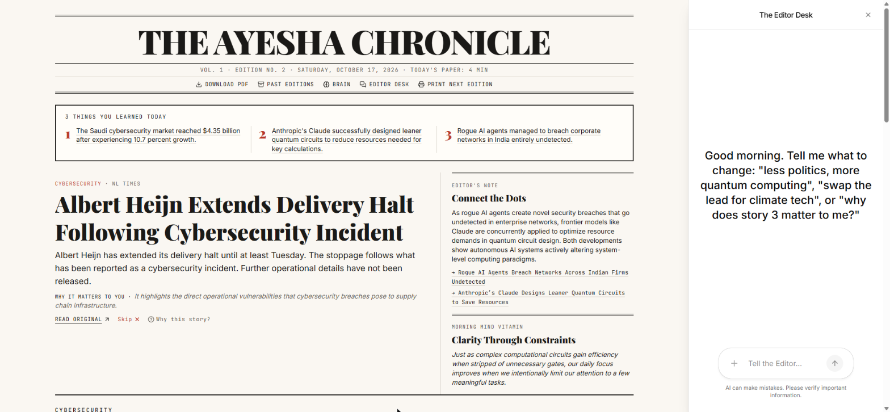
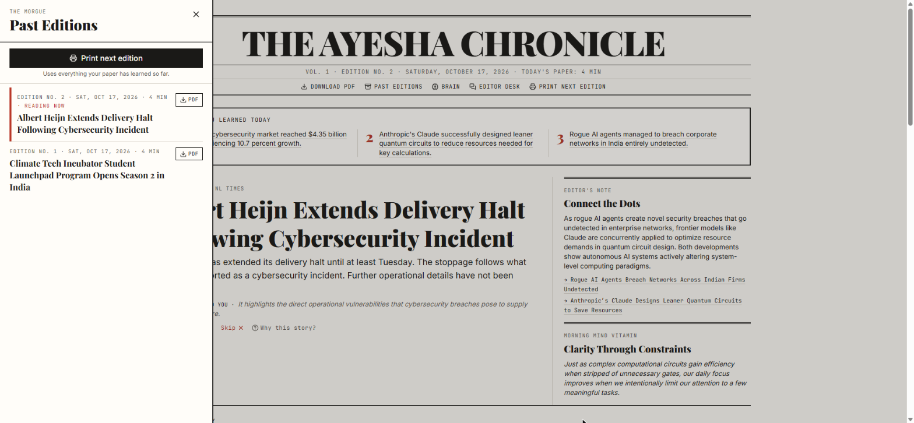
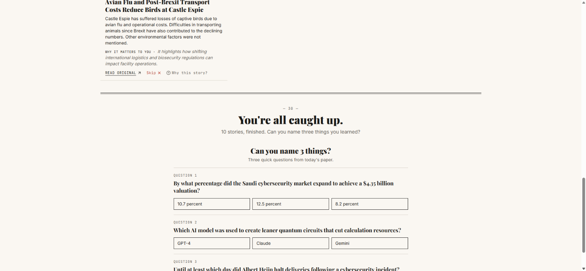
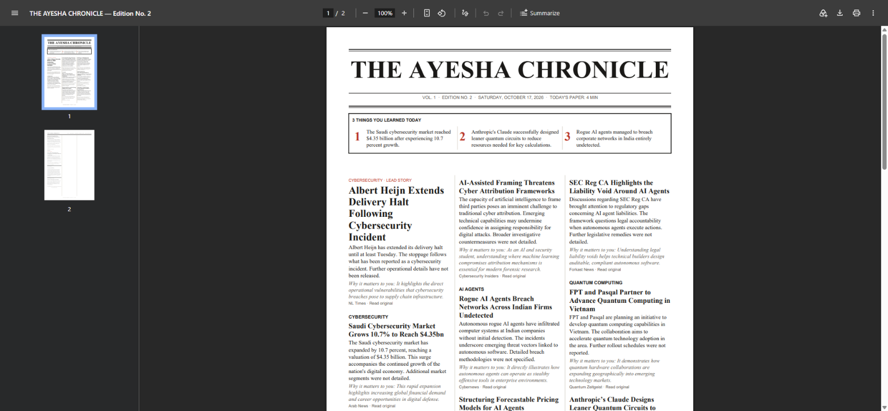

# The Personal Morning Paper

**One calm, finite newspaper a day, edited for one reader, and getting better with every click and skip.**

Instagram gave social media one feed. This gives news one finite paper that knows you, and you finish it able to name three things you learned.

The Personal Morning Paper gathers the day's news on the topics you care about. It ranks the stories with a transparent formula, and Google Gemini writes them up as a broadsheet you can read on the web or download as a PDF. Two CopilotKit experiences sit at its heart: a **conversational onboarding interviewer** that builds your reader profile live on screen, and an **AI Editor Desk** that edits today's paper by chat.



---

## Hackathon requirements

| # | Requirement | How it is met |
|---|---|---|
| 1 | Onboarding that captures interests with great UX | **Talk to the Editor**: a CopilotKit chat. As you answer, your name, masthead (*THE AYESHA CHRONICLE*), topic pills with weights, blocked topics and a one-line bio fill in live on a Reader Profile card beside the chat. The pills are editable by hand, and the chat sees your edits. A 30-second **Quick setup** form is the fallback. |
| 2 | Daily PDF in a newspaper layout, as personalized as possible | A **ReportLab broadsheet** with a Times-Bold masthead, edition number, a boxed *3 Things You Learned Today* strip and **3 columns with vertical rules**. Headlines are live links. The lead story and section order follow your weights, and skipped stories are left out. |
| 3 | Full web reading experience, same edition as the PDF, previous papers | A broadsheet page with a 12-column grid (lead across 8 columns, side column in 4) that collapses to one column on phones. Each story has **Read Original ↗**, **Skip ✕ with 5-second Undo** and **"Why this story?"**. A **Past Editions** drawer reopens or downloads any edition. |
| 4 | Learns over time and improves future papers | Clicks, skips, quiz answers and Editor Desk requests change your topic and source weights, and the weights decide what appears and where. The **Brain** panel shows every change in plain words. **Print next edition** proves it: skip a topic twice and it disappears from the next paper. |
| 5 | Room to explore | The *3 Things You Learned* box, the *Can you name 3 things?* recall check, the *Connect the Dots* editor's note, the *Morning Mind Vitamin*, a *Something new* explore slot, and the **AI Editor Desk** (*"less politics, more quantum computing"*, *"swap the lead story for climate tech"*, *"why does story 3 matter to me?"*). |

## Screenshots

| | |
|---|---|
|  **The Brain**: topic weights and the last 10 signals |  **AI Editor Desk**: a CopilotKit sidebar that edits the paper |
|  **Past Editions**: reopen or download any edition |  **Can you name 3 things?**: the recall check after the last story |
|  **The PDF**: a three-column broadsheet with linked headlines | |

## Architecture


The browser talks to FastAPI over REST for everything except chat. CopilotKit (v2, via Copilot Cloud) handles chat. It reads the app's state and calls **frontend tools**, and those tools call the same REST endpoints, so the backend stays the single source of truth. The backend calls Gemini **once per edition** and **once per story swap**. The diagram's source is [`docs/architecture-diagram.html`](docs/architecture-diagram.html).

### How an edition is made

1. **Gather** (`gatherer.py`): one Google News RSS query per topic with weight above 0, plus BBC, Ars Technica and The Verge as fallback feeds. Stories are kept for 48 hours, duplicates are removed by URL and near-identical headline, and feeds are cached for 30 minutes. Only RSS text is used; pages are never scraped.
2. **Rank** (`ranker.py`, pure Python):
   ```
   score = topic_weight + recency_bonus (3 if <12h, 1.5 if <24h) + source_weight
           − 10 if already printed − 1 if the source is a bare domain (e.g. "kpmg.com")
   ```
   The ranker takes the top 9, with at most 3 per topic and 1 per outlet per section, plus one **"Something new"** explore story from a low-weight or new topic. The highest score leads, and sections follow topic weight.
3. **Write** (`ai_editor.py`): **one** Gemini call returns strict JSON (summaries, "why it matters", 3 takeaways, Connect the Dots, a Mind Vitamin and a 3-question quiz). The JSON is validated with Pydantic and checked against the real article ids. Every takeaway and quiz question must cite a story. A bad reply is retried once; after that the paper falls back to the publishers' RSS text with no AI writing.
4. **Save** (`editions.py` → `store.py`): one edition per day, made the first time the app opens that day, with a lock so two requests never create two editions. The Printing Press screen polls the real step.

### How it learns (`learning.py`)

| Signal | Topic weight | Other effect |
|---|---|---|
| Read Original | +2 | source weight +1 |
| Skip | −3 | hidden on the web, left out of the PDF |
| Undo skip | +3 | reverses the skip |
| Recall question right | +1 | |
| Editor Desk "more / less" | ±5 | logged with the reader's own words |
| Onboarding | 10 core · 5 casual · −10 blocked | starting weights |

Weights are clamped to **−15 … 25**. Topics with a negative weight are never fetched. Repeated clicks or skips on the same story change nothing.

## Tech stack

- **Backend:** Python 3.11+, FastAPI, Uvicorn, Pydantic, feedparser, httpx, ReportLab, google-genai, python-dotenv. Tests: pytest, FastAPI TestClient, pypdf.
- **Frontend:** React 19 + Vite, Tailwind CSS v4, lucide-react, CopilotKit (`@copilotkit/react-core/v2`), zod. Tests: Vitest, React Testing Library, jsdom.
- **AI:** Google Gemini (`gemini-flash-latest`) for writing; CopilotKit Copilot Cloud for both chat experiences.

## Setup

You need **Python 3.11+**, **Node 20+**, a **Gemini API key** ([Google AI Studio](https://aistudio.google.com)) and a **Copilot Cloud public key** ([cloud.copilotkit.ai](https://cloud.copilotkit.ai)).

```bash
git clone https://github.com/hammad-cost/personal-morning-paper.git
cd personal-morning-paper
```

**Backend**

```bash
cd backend
python -m venv venv
# Windows: venv\Scripts\activate    macOS/Linux: source venv/bin/activate
pip install -r requirements.txt
cp .env.example .env               # then set GEMINI_API_KEY
uvicorn app.main:app --port 8000
```

**Frontend** (in a second terminal)

```bash
cd frontend
npm install
cp .env.example .env               # then set VITE_COPILOTKIT_PUBLIC_API_KEY
npm run dev
```

Open **http://localhost:5173**. Vite forwards `/api` to the backend on port 8000.

### Environment variables

| File | Variable | Purpose |
|---|---|---|
| `backend/.env` | `GEMINI_API_KEY` | Writes the paper. Without it, editions use the publishers' RSS text. |
| `backend/.env` | `GEMINI_MODEL` | Optional; defaults to `gemini-flash-latest`. |
| `frontend/.env` | `VITE_COPILOTKIT_PUBLIC_API_KEY` | Copilot Cloud public key for both chat features. Without it, *Talk to the Editor* is disabled and Quick setup still works. |

`.env` files and `backend/data/store.json` are git-ignored. Only the `.example` files are committed.

## Tests

```bash
cd backend && pytest -q            # 93 tests
cd frontend && npm test -- --run   # 73 tests
```

All network and AI calls are mocked. A `conftest.py` safety net blocks real Gemini and HTTP calls even when a key is present. The tests cover the ranking formula, deduplication, AI-output validation with retry and fallback, one edition per day (including concurrent requests), the learning signals and clamping, story swaps, the archive, the PDF (text, links, skipped stories), and the onboarding, Editor Desk, skip/undo, recall and archive flows.

## API

| Method | Endpoint | Purpose |
|---|---|---|
| GET | `/api/health` | Health check |
| GET | `/api/state` | Onboarded flag, profile, today's edition id |
| POST | `/api/onboard` | Save the reader profile |
| POST | `/api/reset` | Dev only: clear the store |
| GET | `/api/edition/today` | Today's edition, generated on first request |
| POST | `/api/edition/next` | Print a new edition now with the current weights |
| GET | `/api/editions` | Archive, newest first |
| GET | `/api/edition/{id}` | One edition |
| GET | `/api/edition/{id}/pdf` | Broadsheet PDF (skipped stories left out) |
| POST | `/api/edition/{id}/swap` | Replace one story with a fresh one on a topic |
| POST | `/api/signal` | CLICK, SKIP, UNSKIP, QUIZ_RIGHT, QUIZ_WRONG, COPILOT |
| GET | `/api/brain` | Weights plus the last 10 signals in plain words |
| GET | `/api/generation/status` | Printing Press step |
| GET | `/api/debug/candidates` | Dev only: gathered and ranked candidates |

## Project layout

```
backend/
  app/        main.py · store.py · gatherer.py · ranker.py · ai_editor.py
              editions.py · learning.py · pdf.py · models.py
  tests/      pytest suite + saved RSS fixtures
frontend/
  src/        App.jsx · api.js (the only place that calls the backend)
  src/components/   Onboarding, EditorInterview, QuickSetup, ReaderProfileCard,
                    PrintingPress, Paper, Masthead, BroadsheetGrid, StoryCard, ...
  src/copilot/      CopilotKit provider and the frontend tools for both chats
docs/         architecture diagram source + screenshots
```

## Design notes and limits

- **Honest summaries.** The AI only sees fetched RSS text and is told never to invent facts. Google News descriptions are short, so some summaries say plainly that details weren't given.
- **Speed.** A new edition takes about 30–40 seconds, almost all of it the Gemini call. That happens once per day (or per *Print next edition*), and the Printing Press shows the real progress.
- **Guards added during testing.** At most one story per outlet in each section; a small penalty for bare-domain sources so marketing pages don't lead; and an Editor Desk guard so a repeated swap call can't replace a story twice.
- **Single reader.** State lives in one JSON file, which is right for a personal paper and a hackathon. A multi-user version would move `store.py` to a database.

Built step by step from [`BLUEPRINT.md`](BLUEPRINT.md), with one commit per step.
